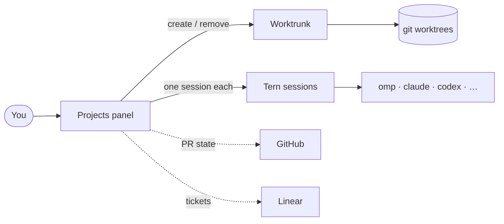

<div align="center">

<h1></h1>

**Mission control for parallel agent work.**

One panel for every branch you have in flight: its worktree, its agents, its pull request and its ticket.<br>
Click a row and you're in that branch's own workspace.


</div>

---

Overseer is a [Tern](https://docs.stencil.so/tern/) plugin for running many coding agents at once without losing track of them.

- **One session per worktree.** Each branch gets its own Tern session with its own tabs and agents. Switching is one click.
- **See every agent at a glance.** Working, waiting for you, finished or failed, right on the row.
- **Sub-worktrees.** When an agent splits a task into one branch per fix, the fixes nest under the task, and their agents keep each other informed.
- **PRs and tickets on the row.** GitHub PR state and the Linear ticket, one click away.
- **Quiet worktrees.** Creation and deletion run through [Worktrunk](https://worktrunk.dev) in the background, hooks and all.
- **Visualize PR.** Turns a pull request into a diagram-first outline for review.

## Install

macOS, [Tern](https://docs.stencil.so/tern/) 0.9.9+, [Worktrunk](https://worktrunk.dev) (`wt`) and Git. Optional extras light up more:

| Add | To get |
|---|---|
| [GitHub CLI](https://cli.github.com) (`gh`), signed in | PR badges, Visualize PR |
| [Linear CLI](https://github.com/schpet/linear-cli) (`linear`), signed in | Ticket links |
| [omp](https://omp.sh) | Ticket agents, Visualize PR, sub-worktrees made by agents |
| [pi-intercom](https://github.com/nicobailon/pi-intercom) and [Bun](https://bun.sh) | Agents in a task keeping each other informed |

```sh
git clone https://github.com/mmnavarr/overseer.git && cd overseer
/Applications/Tern.app/Contents/MacOS/tern plugin link "$PWD"
```

With omp installed, Overseer sets up its omp side by itself.

## Use it

1. **Show Projects** with <kbd>⌘</kbd><kbd>⌥</kbd><kbd>⇧</kbd><kbd>P</kbd>.
2. **Add a repo** with **+** in the panel's header.
3. **Open a worktree** by clicking its row.
4. **Start a new one** with **+** next to a project.
5. **Right-click** a worktree or project for everything else.

<table>
<tr>
<td width="50%"></td>
<td width="50%">

| You see | It means |
|---|---|
| ● green | Session open |
| ● pulsing | Agent working |
| **?** yellow | Agent waiting for you |
| **✔** · **!** | Agent finished · failed while you were away |
| ○ hollow | No session yet |
| **✱** amber | Uncommitted changes |
| **▾ 3** | Three sub-worktrees (click to fold) |
| **creating** | Setup running; **needs you?** if it's asking something |
| 🧊 | Parked in the Ice Box |
| Linear logo · PR icon | The branch's ticket · its PR state |

</td>
</tr>
</table>


### Start work from a ticket

Ask Tern's assistant:

> Create an overseer worktree for ENG-123

You get the branch, its session and an omp agent already reading the ticket.

## Sub-worktrees

A task's worktree can own the worktrees of its sub-tasks. Agents create them for you (or use **Move under…**), each with its own session, PR and ticket, folded under the task with **▾ N**.

Their agents stay in touch: each hears what changed in its family before every prompt, the task's agent is woken when a sub-task's agent needs an answer or opens a PR, and **Brief sub-worktrees…** messages them all. Messages only inform; they never trigger actions.

## Visualize a PR


Right-click a worktree with a pull request → **Visualize PR**. It's read-only: the agent writing the outline can't push, comment or edit anything.

## How it works



Worktrunk owns the worktrees, Tern owns the sessions, and Overseer never deletes a branch. Something stuck? **Show Overseer's operation log** in the command palette says what happened.

Changing Overseer, or want the details? [AGENTS.md](AGENTS.md) has the full reference.

## Credits

Built on [Tern](https://docs.stencil.so/tern/), [Worktrunk](https://worktrunk.dev) and [omp](https://omp.sh). PR icons from [Primer Octicons](https://primer.style/octicons/); Visualize PR follows [humanlayer/skills](https://github.com/humanlayer/skills)' visual-pr skill; the ticket icon is [Linear's logo mark](https://linear.app/brand), a trademark of Linear Orbit, Inc. See [CHANGELOG.md](CHANGELOG.md) for releases and [LICENSE](LICENSE) (MIT).
