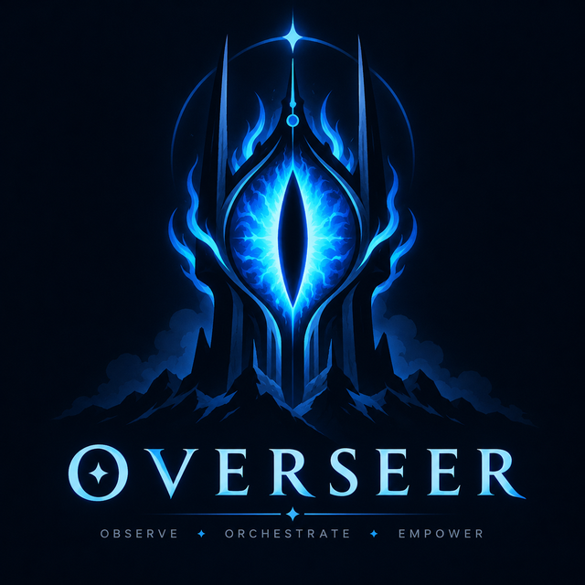
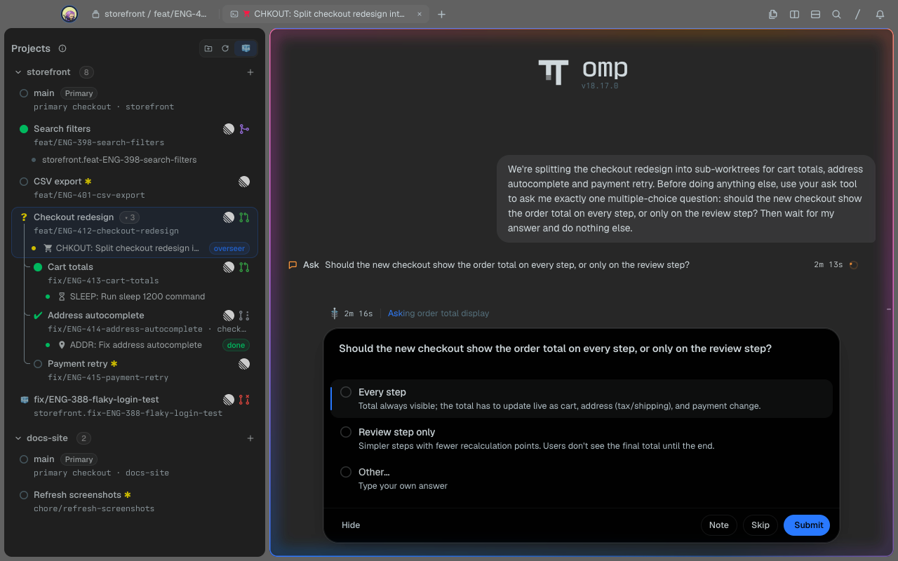
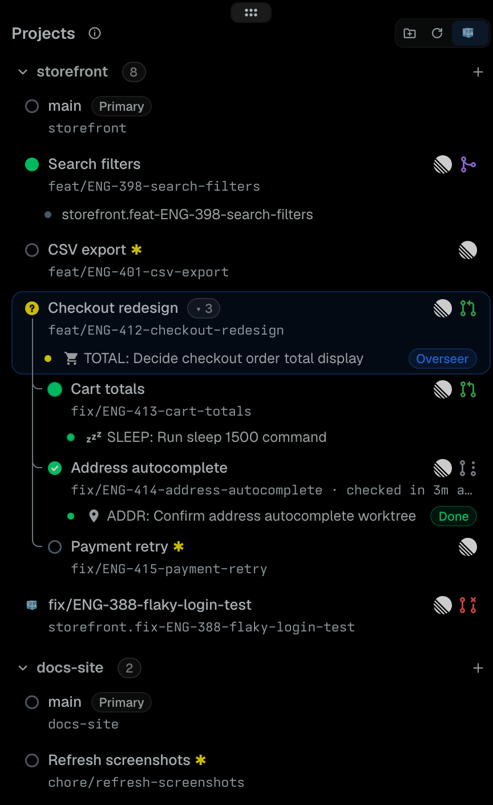
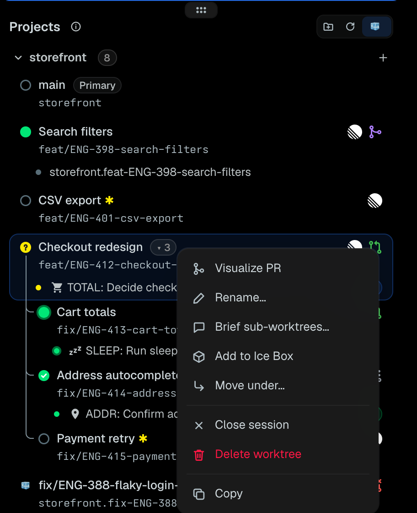
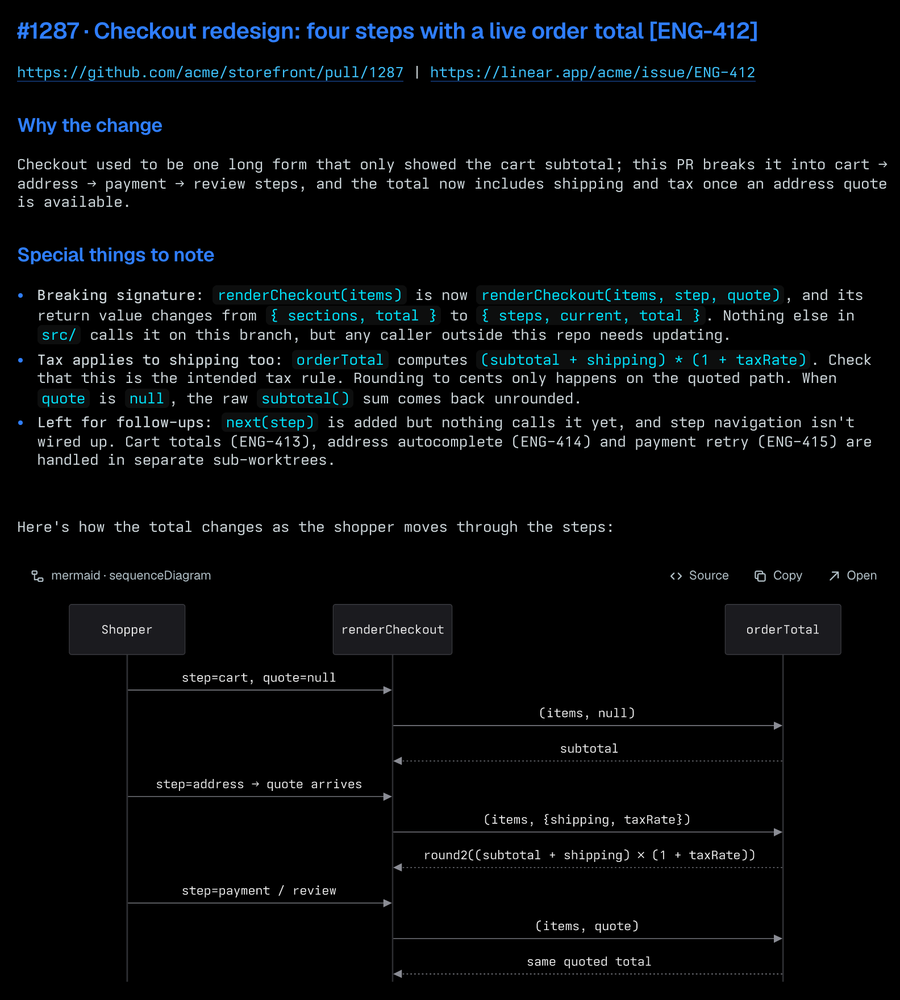
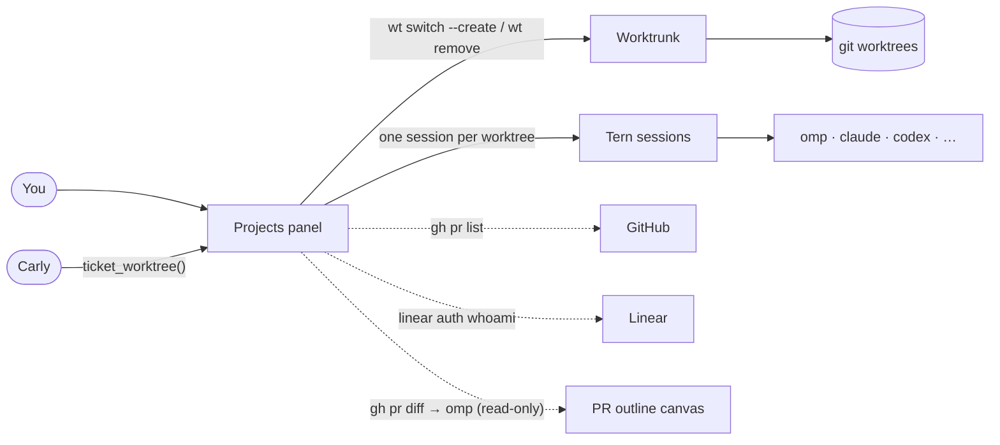

<div align="center">

<h1></h1>

**Mission control for parallel agent work.**

One panel for every branch you have in flight: its worktree, its agents, its pull request and its ticket.<br>
Click a row and you're in that branch's own workspace.



</div>

---

Running five agents on five branches means five checkouts, a pile of terminals, and losing track of which agent is stuck waiting for you. Overseer is a [Tern](https://docs.stencil.so/tern/) plugin that fixes that:

- **Every worktree gets its own Tern session.** Its tabs, shells and agents live there. Switching branches is one click, and nothing bleeds between them.
- **You can see what every agent is doing.** A pulsing dot means an agent is working; a yellow **?** means one is waiting for you; a green **✔** means one finished while you were elsewhere.
- **PRs and tickets sit on the row.** GitHub PR state (draft, open, merged, closed) and the Linear ticket, both one click away, each in a tab of its own.
- **Worktrees come and go safely.** Creation and deletion run through [Worktrunk](https://worktrunk.dev) in the background, with your hooks and approvals intact.
- **Agents can start work for you.** Tell Tern's assistant *"Create an overseer worktree for ENG-123"* and you get a branch, a session and an [omp](https://omp.sh) agent already reading the ticket.
- **PRs can be understood at a glance.** **Visualize PR** turns a pull request into a diagram-first outline, without touching GitHub.

## The panel

The panel stays with you: it sits on the left of whichever tab you're looking at, across every session, and keeps the width you give it. Each project is a local Git repository. Under it, every worktree is a row, and under each row are its open tabs. Click a tab to jump straight to it; a green **done** or red **failed** badge marks an agent turn that ended while you were elsewhere. Tab names drop what the row already shows: a GitHub pull request page reads `#123 <title>` without its author and repository, and omp's ` · #123` suffix is left off (hover a tab for its full name). Hover a row for its branch, path, line counts, ahead/behind and PR.

<table>
<tr>
<td width="50%"></td>
<td width="50%">

| You see | It means |
|---|---|
| ● green | A session is open |
| ● green, pulsing | An agent is working |
| **?** yellow | An agent is waiting for your answer |
| **✔** green | An agent finished while you were looking elsewhere (clears when you open its tab) |
| **!** red | An agent's turn failed while you were looking elsewhere |
| ○ hollow | No session yet; click to open one |
| **✱** amber | Uncommitted changes |
| **conflicts** | A merge or rebase is stuck |
| Linear logo | The branch names a ticket (`feat/ENG-123-…`) |
| PR icon | Draft, open, merged or closed PR |
| 🧊 | Parked in the Ice Box |

</td>
</tr>
</table>

## Install

You need macOS and:

| | Required for | |
|---|---|---|
| [Tern](https://docs.stencil.so/tern/) desktop | everything | 0.9.9 or later |
| [Worktrunk](https://worktrunk.dev) (`wt`), Git, Bash | everything | tested with wt 0.40.0 |
| [GitHub CLI](https://cli.github.com) (`gh`), signed in | PR badges, Visualize PR | optional |
| [Linear CLI](https://github.com/schpet/linear-cli) (`linear`), signed in | ticket links | optional |
| [omp](https://omp.sh) | ticket agents, Visualize PR | optional |

```sh
git clone https://github.com/mmnavarr/overseer.git
cd overseer
/Applications/Tern.app/Contents/MacOS/tern plugin link "$PWD"
```

Linking reloads the plugin whenever the source changes. Use `tern plugin install "$PWD"` instead if you'd rather have a frozen copy.

To let omp agents create [sub-worktrees](#sub-worktrees), link the skill once:

```sh
ln -s "$PWD/skills/overseer-subworktree" ~/.omp/agent/skills/overseer-subworktree
```

## Use it

1. **Show Projects:** <kbd>⌘</kbd><kbd>⌥</kbd><kbd>⇧</kbd><kbd>P</kbd>, or **Show or hide Projects** in the command palette. Press it again while the panel has focus to hide it.
2. **Add a repo:** **+** in the header opens the folder picker.
3. **Open a worktree:** click its row. Its session opens, and the panel comes with it.
4. **New worktree:** **+** next to a project. Type a branch name (and, if you like, a friendly display name). Setup runs in a background **Create** tab, and a notification tells you when it's ready.
5. **Everything else is a right-click away:**



- **Visualize PR** for a reviewer's outline of the branch's pull request
- **Rename…** changes the row's label (the branch stays as it is)
- **Add to Ice Box** parks a worktree at the bottom; 🧊 in the header hides or shows parked ones
- **Close session** stops its programs and closes its tabs straight away, without a confirmation (the files stay)
- **Delete worktree** runs `wt remove` straight away when the worktree is clean. With uncommitted or untracked changes it first lists them, like `git status --short` with line counts, and **Force delete** removes the worktree with them (`wt remove --force`). The branch is always kept. Its session closes once the directory is gone. A worktree with [sub-worktrees](#sub-worktrees) asks first whether they go too.
- **Move under…** makes a worktree a sub-worktree of another; **Make top-level** undoes it
- A worktree removed outside Overseer (`wt remove`, `wt merge`, `git worktree remove`) shows as **worktree gone** while its session is open. Click it to see the session; **Close session** closes it.
- On a project: **Change base branch…**, **Set Linear workspace…** and **Remove project…** (stops showing it; the repository, worktrees and sessions stay, and adding it again brings back its names and Ice Box)

### Start work from a ticket

Ask Tern's assistant, Carly:

> Create an overseer worktree for ENG-123

Overseer creates `feature/ENG-123` from the project's base branch and opens its session. Then it starts omp with:

> *Please read ticket ENG-123 to understand your task and ask any questions you have before we start*

The project is the one you're in, or name it: *"…for ENG-123 in api"*. If the branch already exists, Carly tells you instead.

### Sub-worktrees

A worktree can own others: an agent working on one task that spins off a branch per fix keeps those fixes under its row instead of scattering them through the list.

```text
● Space/Website Fixxer  ▾ 5
  feature/space-website-lurker
  │ ○ fix/website-coingecko-caps
  │ ○ fix/website-drain-on-term ✱
  │ …
```

- **Agents create them** with the `overseer-subworktree` skill (link it once, see [Install](#install)): `overseer-subworktree <branch> [--base <ref>]`, run inside the owning worktree. The owner is wherever it runs, never an argument, so an agent can only attach work to the worktree it's in. It runs `wt switch --create` with your hooks and approvals as usual.
- **You adopt existing ones** with **Move under…**, which lists the top-level worktrees; **Make top-level** puts one back.
- **The badge folds them.** `▾ 5` shows how many; click it to fold. Folded, it takes the color of the sub-worktree agent that most needs you (amber waiting, red failed, green done, accent working). The worktree you're in always shows.
- **Each keeps its own session**, menu, PR and ticket links. Nesting is one level deep: a sub-worktree of a sub-worktree shows under the top owner.
- **Deleting the owner asks.** **Delete only this** leaves the sub-worktrees, which move to the top level. **Delete all** also removes every sub-worktree without uncommitted changes; one with changes is kept and moves up. The owner still gets its usual Force delete check.
- **Ice Box:** parking the owner parks its sub-worktrees with it.
- The link is Worktrunk's per-branch variable `overseer-parent` on the sub-worktree's branch (`wt config state vars get --branch=<branch> overseer-parent`), so agents and `wt` see it too. Git branches stay independent: nesting is for the panel, not ancestry.

### Visualize a PR



Overseer fetches the PR's metadata and full diff from GitHub, then has omp write an outline following HumanLayer's [visual-pr](https://github.com/humanlayer/skills) skill: why the change exists, what to watch for, and Mermaid diagrams, file-tree diffs and pseudocode. The local checkout only adds surrounding context. It takes a minute or two, and unchanged PRs reopen instantly from a cache.

It's **read-only by construction**: omp runs with only read/grep/glob tools and no shell, so it can't push, comment or edit anything.

## How it works



- **Worktrunk owns the worktrees.** Overseer calls `wt` and never passes `--yes` or `--no-hooks`, and passes `--force` only after you confirm the listed changes. Your hooks and approval prompts run in a visible tab.
- **Tern owns the sessions.** Overseer remembers which session belongs to which worktree and switches between them.
- **The panel follows you.** Tern plugins can't pin a sidebar to the window, so Overseer keeps one Projects panel per window and moves it into whichever tab you're on.
- **Everything else is a read.** PR badges, ticket links, agent status and change counts come from `gh`, `linear`, `git` and Tern's own agent state.

## Safety

- Creation never fetches, pulls, or checks out anything in your primary checkout.
- Deletion rechecks the repository and branch right before it runs, and cleanliness too unless you confirmed a force delete. It never deletes a branch. The primary checkout can't be deleted.
- Ignored files are removed with a deleted worktree's directory, so copy out anything you need first.
- Branch names and paths are passed as arguments, never as shell text.

---

## For agents

This section is for coding agents (and humans) changing Overseer. It favors completeness over brevity.

### Runtime model

Overseer is a Tern plugin written in Luau. `plugin.toml` declares two entry points:

- `host.luau` runs in Tern's host and renders the `overseer.form` block, the native form used for New worktree, Rename, Change base branch and Set Linear workspace. `input.luau` is its Unicode-aware text editing.
- `window.luau` runs once per Tern window. It owns the Projects panel (a canvas that follows you between tabs), event hooks, the background job tracker, the Carly export, and Visualize PR canvases.

Tern APIs are typed in the definitions Tern generates: `/Applications/Tern.app/Contents/MacOS/tern plugin types <dir>` writes `tern.d.luau`. Read it before using an API you haven't used here.

### The 50 ms rule (read this first)

Tern gives **every window-half callback 50 ms of Lua**. Native calls (the `cx` API, `tern.kv`, starting a process) don't count, but a callback may take at most 500 ms of wall time with them. A callback past either limit is cut short (`pcall` doesn't help, and its `tern.kv` writes can be lost) and Tern **pauses that hook**: 5 s, doubling for each repeat within 10 minutes, up to 5 minutes. Timers, process results and fetches that come due during a pause wait for it to end; they aren't dropped. A full draw takes under 10 ms.

`budget.luau` owns this:

- **Work runs in timer callbacks; every other hook only queues it.** Clicks (`canvas_action`), commands, and tab, pane, focus and agent events call `separately(label, fn)` or `followSoon()`, and return. A paused `canvas_action` hook would swallow every click until the pause ends, so it must stay too small to trip. `budget.later(label, ms, fn)` is the only way to start a timer: it labels the callback so a timer pause names it.
- **Pauses are logged.** The `budget` event logs `Overseer: Tern paused its <hook> hook for N s after a callback (<label>) ran over 50 ms` and, when the hook resumes, runs `followSoon` to catch the panel up.
- **Make every step safe to cut short.** A callback that's cut short leaves its in-memory state behind and can lose its kv writes. So write the record that says "done" last: `finishForm` drops a form's `pending-form` record only after the panel is back, a creation records `launched` on the form before finishing it, and `checkJobs` takes a job off the books before deleting its receipt. A form found without its record can never answer, so `forms` puts Projects back in its place.
- There is **one panel per window**, so a draw costs the same however many sessions are open.
- **Start processes only through `wt.spawn`.** It starts the process right away and hands the result, or a failure to start, to the caller with a `cx`, logging errors in the callback under the command's name.

Tern doesn't run plugin timers while its window sits idle with no events; the next event runs every overdue timer. An isolated test window behind other windows therefore looks frozen until you click it.

When debugging an overrun, read the log: `exceeded its budget; paused … hook="timer"` is followed by Overseer's line naming the callback that ran over.

### Files

| File | What lives there |
|---|---|
| `window.luau` | Project registry, model building (`model`), drawing (`draw`/`redraw`), the following panel (`slot`, `pin`, `follow`, `followSoon`, `togglePanel`), session binding (`ensureSession`, `openWorktree`), forms swapped into the panel's slot (`openForm`, `forms`, `answerForm`, `finishForm`), background jobs (`launchCreation`, `checkJobs`, `jobFinished`), ticket links (`ticketOf`, `ticketFor`), Linear workspace lookup, Visualize PR canvases, the Carly export, hooks and the 750 ms `tick`. |
| `budget.luau` | Living with the 50 ms rule: `later` (labelled timer callbacks), `process` (process results with logged errors), and `describe` (the log line for a `budget` event). |
| `worktrunk.luau` | Every external command: `wt list`, validation, the creation and removal command lines, `git` status, `gh pr list`/`gh pr view`/`gh pr diff`, `linear auth whoami`. Commands are argv arrays started by `spawn`; `find_executable` checks Homebrew, `/usr/local/bin`, `~/.bun/bin` and `~/.local/bin`. |
| `visualize.luau` | Visualize PR: prompt, read-only omp invocation, output extraction, cache. |
| `view.luau` | Pure render: model → Tern UI node tree (rows, badges, tab rows, confirm strips, menus). Actions are Tern's own kinds (`button`, `buttons`, `badge`, `card`, `empty`, `shimmer`, menu rows); no HTML buttons. |
| `worktree-operation.sh` | The helper that runs `wt switch --create` / `wt remove` in a visible terminal and writes an atomic completion receipt. |
| `host.luau`, `input.luau` | The native form block and its text input. |
| `styles.css`, `icons.css` | Panel layout and status marks only: Tern's kinds draw buttons, badges, cards and menus themselves. The canvas has no `font` prop, so `styles.css` sets the panel in the UI face (`--sans`) and branches and paths back in `--mono`. `icons.css` is **generated** by `icons/generate-css.py` (plugin stylesheets can't load files, so icons are embedded as data URIs). |
| `skills/visual-pr/` | HumanLayer's visual-pr skill, vendored unchanged (MIT). |
| `skills/overseer-subworktree/` | The omp skill and script agents use to create a sub-worktree of the worktree they run in. |
| `tests/test_worktree_operation.py`, `tests/test_subworktree.py` | Real Git/Worktrunk tests for the helper and the sub-worktree script. |

### State

Tern's plugin KV (`~/Library/Application Support/Tern/plugin-data/overseer/kv.json`), via `tern.kv`:

| Key | Shape | Notes |
|---|---|---|
| `projects` | `[{id, name, path, base, linear?}]` | `id` is the repository's shared Git directory, so linked checkouts dedupe. `linear` overrides the CLI workspace. |
| `worktree-names` | `{[projectId]: {[path]: name}}` | Display names. Removed when Overseer deletes the worktree, or when a refresh finds it gone. |
| `sessions` | `{[path]: {id, host, project}}` | Worktree → Tern session binding. A refresh drops bindings of gone worktrees whose session is closed. |
| `icebox` | `{[projectId]: {[path]: true}}` | Parked worktrees. `show-icebox` is the header toggle. |
| `jobs` | `{[id]: {kind = "create" \| "remove", project, receipt, pane, …}}` | Running creations and deletions; creations also carry `branch`, `displayName?` and `agentPrompt?`. Persisted so a plugin reload doesn't lose them. |
| `panel-open`, `panel-share` | `boolean`, `number` | Whether you want the Projects panel shown (the shortcut sets it), and its width as a share of the tab. |
| `pending-form:<pane>`, `form:<token>` | `{token, mode, project, path?, response?, launched?}`, the form's answer | An open form's request, keyed by its pane, and the answer the form block posts. `forms` moves the answer into the request (`response`) so a reload resumes it. |
| `agents-finished` | `{[paneId]: "done" \| "failed"}` | Agent turns that ended while their tab wasn't shown. Cleared when the tab is shown, the agent starts again, or the pane closes. |

Files under `tern.plugin.data`: `creation-<id>.status` and `removal-<id>.status` receipts written by the helper, and the `visual-pr/<project>-<pr>-<headsha>.md` outline cache.

In-memory only: the per-project `cache` (worktrees, PRs, gone paths with open sessions, loading/error flags), `rendered` signatures per panel pane, the panel's pane and last tab, the Linear default workspace, open outline canvases.

### Flows

**Refresh.** `refresh` runs `wt list --format=json` per project, beside `refreshParents` (`wt config state get --format=json`, keeping the `overseer-parent` vars as `entry.parents`; a failed read keeps the last links), then `refreshPullRequests` (one `gh pr list` per GitHub project, at most every 2 minutes, immediately after ↻ or a worktree set change). An open panel refreshes every 15 s from `tick`.

**Sub-worktrees.** `owners(entry)` maps each worktree to the top of its `overseer-parent` chain among the listed worktrees (a link past the listing stops there, a cycle or a primary checkout as child stays on top). `model` puts owned worktrees in their owner's `children` (Ice Box ones last; an iced owner parks them; `folded` is in memory) with `childAgent` the most urgent agent among them; the view draws them in a `c<hex>` column after the owner's group, so path recovery (`w<hex>.row`) works unchanged. **Move under…** offers only top-level worktrees (`cx:pick`), and both it and **Make top-level** go through `setParent`: an optimistic `entry.parents` update, `wt config state vars set|clear`, then `refreshParents`. Deleting an owner opens the `delete-family` confirmation; **Delete all** queues one `beginRemoval` per sub-worktree with `keepIfDirty` (a dirty one is kept with a toast instead of asking) and then the owner's own.

**Gone worktrees.** After each successful listing, `reconcileGone` treats a recorded path that isn't listed, isn't being deleted and isn't on disk as removed outside Overseer. It drops the path's `worktree-names` and `icebox` entries. If the path's bound session is still open it goes in `entry.gone`, and `model` adds it as a `gone` row (`goneNode` in the view: click switches to the session, the menu offers only **Close session**). Otherwise the binding is dropped. Never closing these sessions automatically is deliberate: an agent that removes its own worktree would be killed before you read its reply.

**The following panel.** Tern panes belong to one tab, and plugins can't add a window-level sidebar, so the window keeps exactly one Projects slot and moves it into whichever tab is shown, left of everything and full height. `slot` finds it: the navigator canvas or a form shown in its place, adopting what a reload left open and closing any extra. `pin` moves it with `move_to_tab` (or `unpark`) then `move(…, "left")` and steers the split ratio to the remembered share, since Tern resizes in cells and hidden tabs measure differently. `followSoon` queues `follow` on `focus`, `tab_created`, `tab_closed`, `pane_created`, `pane_closed`, `window_start` and every `tick`. Moves work across sessions. Edge cases:

- **Last terminal in a tab closed:** the panel would be left alone, so `follow` parks it; the tab closes as Tern would have, and the next shown tab (or new tab) takes the panel back.
- **Overseer closes a session:** `closeManagedSession` switches away and calls `follow` first, so the panel leaves before the session closes.
- **Tern closes the panel's tab or session:** the panel dies with it. If you wanted it (`panel-open`) and its last tab is gone, `follow` opens a fresh one in the shown tab. If its tab is still there, you closed the panel yourself, and it stays closed until the shortcut.

**Create.** Form or Carly → `wt.validate` → `launchCreation` opens a background tab running `worktree-operation.sh` and records a job → `checkJobs` (on `tick`) reads the receipt → on success: toast, apply the display name by branch (`applyCreatedName`), and for ticket worktrees `startTicketAgent` opens the session and calls `cx.agents:start({command = "omp", prompt = …})`. Creation succeeded means `wt` exited 0, not that every hook succeeded.

**Delete.** `beginRemoval`: `wt.validate_removal` (repository identity, branch) while the row shows **checking** → clean: removal job right away. Dirty: `wt.local_changes` (`git status --porcelain=v1 -z --no-renames` plus `git diff HEAD --numstat`, first 200 entries) fills the confirmation; **Force delete** reruns `beginRemoval` with `force`, and the helper runs in `force-remove` mode (`wt remove --force`, no cleanliness check). Either way: removal job in a background tab → receipt → close the worktree's session only if the directory is gone, then drop its name, binding and Ice Box entry. Cancelling during a check never starts a deletion (`removalChecks`).

**Agent status.** `agentActivity` reads `cx.agents:list()`: `state == "waiting_input"` → waiting, `"working"` → working, otherwise the pane's `agents-finished` mark (done or failed). An `agent_finished` event with result `done` or `failed` sets that mark unless the agent's tab is shown; `agent_state` back to working or waiting clears it, and `markSeen` (after every `follow`) clears marks whose tab is shown or whose pane is gone. For agent CLIs in plain terminals (`omp`, `pi`, `claude`, `codex`, `opencode`, `gemini`, `aider`, `amp`, `cursor-agent`, `crush`, `goose`) it uses the pane's `busy` flag (working only). Per session and tab the state that most needs you wins: waiting, then failed, then done, then working.

**Links.** Ticket and PR icons send `link=<url>`. `cx:open` puts a URL in a browser split beside the focused pane whatever `how` says, so `openLink` moves the new browser pane into a tab of its own.

**Remove project.** Drops the project from `projects` and its in-memory cache; refuses while a creation or deletion runs for it. `worktree-names`, `icebox` and `sessions` stay, so adding the repository again brings them back.

**Ticket links.** `ticketOf` takes the first uppercase `ABC-123` in the branch (`%f[%w](%u[%u%d]*%-%d+)%f[%W]`), so `chore/stage-1` doesn't count. The workspace is `project.linear`, else the slug from `linear auth whoami` (looked up once; ↻ retries a failure). URL: `https://linear.app/<workspace>/issue/<id>`.

**Visualize PR.** `wt.pull_request_meta` (`gh pr view --json …`) and `wt.pull_request_diff` (`gh pr diff > file`) write the PR into a temp dir under plugin data. Then `omp -p --no-session --no-extensions --no-skills --no-title --tools=read,grep,glob "<prompt>"` runs in the worktree with a 10-minute timeout. Its stdout from the first Markdown heading becomes the canvas. The read-only guarantee is the tool allow-list. Keep it that way: never add shell, edit or write tools, and never let it call `gh`.

**Carly.** `tern.carly.export("ticket_worktree", …)` validates the id, resolves the project (argument by name or path, else the current session's project), validates the branch and starts creation. It replies once creation *starts* (setup can outlast Carly's 120 s limit). `tern.carly.context` tells Carly the registered project names.

### Developing

Run the helper's tests (they use temporary repos, config and approvals):

```sh
python3 -B tests/test_worktree_operation.py -v
python3 -B tests/test_subworktree.py -v
bash -n worktree-operation.sh
```

Smoke-test UI changes in an **isolated Tern window** so your real sessions are untouched:

```sh
D=$(mktemp -d); mkdir -p "$D/config"
TERN_CONFIG_DIR="$D/config" tern plugin link "$PWD"
TERN_CONFIG_DIR="$D/config" TERN_DAEMON_SOCKET="$D/daemon.sock" \
  /Applications/Tern.app/Contents/MacOS/tern --control "$D/desktop.sock"
```

Drive it with `tern ctl --control "$D/desktop.sock" …`:

- `ready`, `palette Projects`, `key Enter`, `click X Y [right]`, `shot NAME` (screenshots land in `target/shots/tern/live/`)
- `tree "[data-role=overseer\.worktreeRow]"` returns node rects and text
- `a11y` returns menu items and their bounds
- `carly lua "…"` runs Lua with a window `cx`, and `state` shows the result under `.carly.last_tool`

Seed projects by writing `$D/config/plugin-data/overseer/kv.json` before launch.

Other conventions:

- Editing any file in a linked plugin reloads it in every running Tern. Develop in a separate checkout linked into an isolated window so your everyday Overseer isn't reloaded mid-edit.
- After changing an icon, run `python3 icons/generate-css.py`.
- Bump `version` in `plugin.toml` for user-visible changes and add an entry to [`CHANGELOG.md`](CHANGELOG.md). A change to how the panel or its state is structured is a major version.
- Keep external commands in `worktrunk.luau` as argv arrays. Shell is only used where a redirect is needed, with arguments as `$0…$n`.

### Known limitations

- macOS only (folder picker, paths, Tern desktop).
- Visualize PR fails on PRs whose diff exceeds GitHub's 20,000-line API limit (`gh pr diff` returns HTTP 406). The tab shows the error.
- The panel moves into each tab you switch to, so every switch animates briefly and resizes the terminals in both tabs (full-screen programs redraw). In a tab split top-and-bottom it sits beside the top half.
- A plugin reload during a Visualize PR run, including the one Tern does when you edit a file in a linked plugin, ends the run and leaves its tab on the waiting message. Run it again.
- Multiple Tern windows work but haven't been exhaustively tested together.

---

## Credits

- Pull request icons: [Primer Octicons](https://primer.style/octicons/) (MIT, `icons/LICENSE`).
- Visualize PR follows [humanlayer/skills](https://github.com/humanlayer/skills)' visual-pr skill, vendored at `ca7c8088db69` (MIT, `skills/visual-pr/LICENSE`).
- The ticket icon is Linear's official logo mark from [Linear's brand assets](https://linear.app/brand) (`icons/linear.svg`). Linear and its logo are trademarks of Linear Orbit, Inc., used here only to link to Linear tickets.
- Built on [Tern](https://docs.stencil.so/tern/), [Worktrunk](https://worktrunk.dev) and [omp](https://omp.sh).

## Changelog

See [CHANGELOG.md](CHANGELOG.md). 2.0 replaced the panel-per-session layout with one panel that follows you between tabs.

## License

[MIT](LICENSE)
