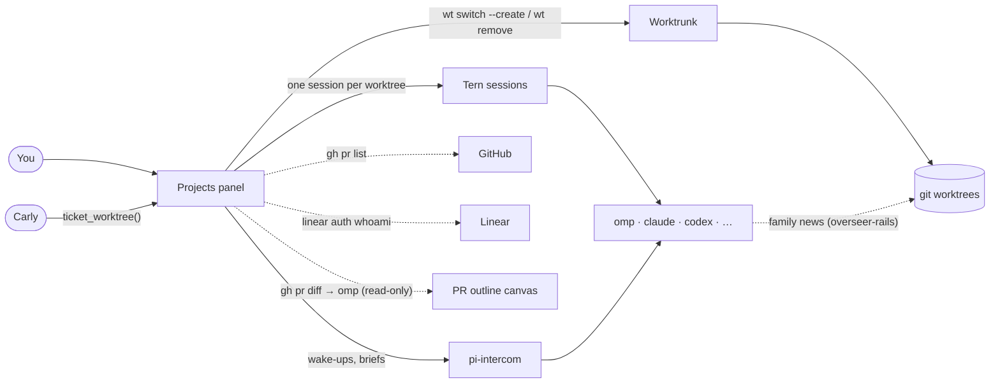

<div align="center">

<h1></h1>

**Mission control for parallel agent work.**

One panel for every branch you have in flight: its worktree, its agents, its pull request and its ticket.<br>
Click a row and you're in that branch's own workspace.


</div>

---

Running five agents on five branches means five checkouts, a pile of terminals, and losing track of which agent is stuck waiting for you. Overseer is a [Tern](https://docs.stencil.so/tern/) plugin that fixes that:

- **Every worktree gets its own Tern session.** Its tabs, shells and agents live there. Switching branches is one click, and nothing bleeds between them.
- **You can see what every agent is doing.** A pulsing dot means an agent is working, a yellow **?** that one is waiting for you, a green **✔** that one finished while you were elsewhere.
- **PRs and tickets sit on the row.** GitHub PR state and the Linear ticket, each one click away.
- **Big tasks stay organized.** When an agent splits a task into one branch per fix, those [sub-worktrees](#sub-worktrees) nest under the task's row, and their agents [keep each other informed](#coordination).
- **Worktrees come and go quietly.** Creation and deletion run through [Worktrunk](https://worktrunk.dev) in the background, with your hooks and approvals intact. A row speaks up only when setup needs you.
- **Agents can start work for you.** Tell Tern's assistant *"Create an overseer worktree for ENG-123"* and you get a branch, a session and an [omp](https://omp.sh) agent already reading the ticket.
- **PRs can be understood at a glance.** **Visualize PR** turns a pull request into a diagram-first outline, without touching GitHub.

## Install

You need macOS and:

| | Required for | |
|---|---|---|
| [Tern](https://docs.stencil.so/tern/) desktop | everything | 0.9.9 or later |
| [Worktrunk](https://worktrunk.dev) (`wt`), Git, Bash | everything | tested with wt 0.40.0 |
| [GitHub CLI](https://cli.github.com) (`gh`), signed in | PR badges, Visualize PR | optional |
| [Linear CLI](https://github.com/schpet/linear-cli) (`linear`), signed in | ticket links | optional |
| [omp](https://omp.sh) | ticket agents, Visualize PR, [sub-worktrees](#sub-worktrees) made by agents | optional |
| [pi-intercom](https://github.com/nicobailon/pi-intercom) omp plugin, [Bun](https://bun.sh) | [coordination](#coordination) | optional |

```sh
git clone https://github.com/mmnavarr/overseer.git
cd overseer
/Applications/Tern.app/Contents/MacOS/tern plugin link "$PWD"
```

Linking reloads the plugin whenever the source changes; `tern plugin install "$PWD"` installs a frozen copy instead.

### omp integration

With [omp](https://omp.sh) installed, there's nothing to set up: each time Overseer loads, it links its omp half into omp. That half is `omp/`, an omp plugin package named `overseer-omp`:

| Piece | What it does |
|---|---|
| `overseer-subworktree` skill | Teaches agents to create worktrees the right way: sub-worktrees for their task's sub-tasks, top-level worktrees otherwise |
| `overseer-worktrees` rule | Stops an agent that types a raw `git worktree add` or `wt switch --create` and points it at the skill |
| `overseer-rails` extension | Keeps the agents of a worktree family informed (needs pi-intercom) |

They load in omp sessions started after the link (`/new` restarts one); `omp plugin list` shows it. `omp plugin disable overseer-omp` turns them off, and Overseer leaves it that way. Overseer also removes the symlinks into `~/.omp/agent` that earlier versions had you make, so omp doesn't load them twice. Using omp without Tern? Link it yourself: `omp plugin link "$PWD/omp"`.

## Use it

1. **Show Projects:** <kbd>⌘</kbd><kbd>⌥</kbd><kbd>⇧</kbd><kbd>P</kbd>, or **Show or hide Projects** in the command palette. Press it again while the panel has focus to hide it.
2. **Add a repo:** **+** in the panel's header opens the folder picker.
3. **Open a worktree:** click its row. Its session opens, and the panel comes with it.
4. **New worktree:** **+** next to a project. Type a branch name and, if you like, a display name. The row appears straight away as **creating** and becomes a normal row when setup is done.
5. **Everything else is a right-click away** (see [the menus](#the-menus)).

The panel stays on the left of whichever tab you're looking at, across every session, and keeps the width you give it. Each project is a local Git repository, each worktree is a row, and the worktree's open tabs are listed under it. Click a tab row to jump to that tab; hover a worktree row for its branch, path, line counts, ahead/behind and PR.

<table>
<tr>
<td width="50%"></td>
<td width="50%">

| You see | It means |
|---|---|
| ● green | A session is open |
| ● green, pulsing | An agent is working |
| **?** yellow | An agent is waiting for your answer |
| **✔** green · **!** red | An agent finished · failed while you were elsewhere (clears when you open its tab) |
| ○ hollow | No session yet; click to open one |
| **✱** amber | Uncommitted changes |
| **conflicts** | A merge or rebase is stuck |
| **creating** | Setup is running; the row says how long and which step |
| **needs you?** | Setup is asking a question, or has printed nothing for a minute; click to see it |
| **▾ 3** | Three sub-worktrees; click to fold them |
| **2 new** | Overseer messages for this worktree's agent since you last looked |
| **worktree gone** | Removed outside Overseer; its session is still open |
| Linear logo · PR icon | The ticket the branch names (`feat/ENG-123-…`) · the PR's state |
| 🧊 | Parked in the Ice Box |
| **done** · **failed** on a tab | That tab's agent turn ended while you were elsewhere |
| **overseer** on a tab | The session Overseer's [coordination](#coordination) messages go to |

</td>
</tr>
</table>

Tab names leave out what the row already says: a GitHub pull request tab reads `#123 <title>`, without its author and repository. Hover a tab for its full name.

### The menus


| On a worktree | |
|---|---|
| **Visualize PR** | A reviewer's outline of the branch's pull request ([below](#visualize-a-pr)) |
| **Rename…** | Changes the row's label; the branch stays as it is |
| **Add to Ice Box** | Parks the worktree at the bottom; 🧊 in the header shows or hides parked ones |
| **Move under…** · **Make top-level** | Makes it a [sub-worktree](#sub-worktrees) of another, or undoes that |
| **Brief sub-worktrees…** | Sends your message to the agents of all its sub-worktrees |
| **Close session** | Stops its programs and closes its tabs at once; the files stay |
| **Delete worktree** | Removes a clean worktree at once. With uncommitted or untracked changes it first lists them, like `git status --short`, and asks you to **Force delete**. Branches are always kept, and the session closes once the directory is gone. A worktree with sub-worktrees asks whether they go too. |

| On a project | |
|---|---|
| **Change base branch…** | The branch new worktrees start from |
| **Set Linear workspace…** | Where ticket links point |
| **Remove project…** | Stops showing it. The repository, worktrees and sessions stay, and adding it again brings back its names and Ice Box. |

On a tab, **Make overseer session** picks which of a worktree's agents gets Overseer's messages.

A worktree removed outside Overseer (`wt remove`, `wt merge`, `git worktree remove`) shows as **worktree gone** while its session is still open, so you can read what its agent last said. Its menu offers only **Close session**.

### Start work from a ticket

Ask Tern's assistant, Carly:

> Create an overseer worktree for ENG-123

Overseer creates `feature/ENG-123` from the project's base branch and opens its session. Then it starts omp with:

> *Please read ticket ENG-123 to understand your task and ask any questions you have before we start*

The project is the one you're in, or name it: *"…for ENG-123 in api"*. If the branch already exists, Carly tells you instead.

## Sub-worktrees

A task's worktree can own the worktrees of its sub-tasks. When an agent splits a job into one branch per fix, the fixes sit under the task instead of scattering through the list:

```text
● Space/Website Fixxer  ▾ 3
  feature/space-website-lurker
  │ ○ fix/website-coingecko-caps
  │ ○ fix/website-drain-on-term ✱
  │ ○ fix/website-logging-levels
```

- **Agents make them.** With the [omp integration](#omp-integration), an agent in a task's worktree creates the worktrees of its sub-tasks as sub-worktrees, and can hand each one a brief so a fresh agent starts on it there. Work started from the primary checkout, or unrelated to the task, gets an ordinary top-level worktree.
- **You arrange them** with **Move under…** and **Make top-level**.
- **Each is a full worktree**, with its own session, menu, PR and ticket. Nesting is one level deep.
- **Fold them** with the `▾ N` badge. Folded, it takes the color of the sub-worktree agent that most needs you; the worktree you're in always shows.
- **Deleting the owner asks.** **Delete only this** moves its sub-worktrees to the top level; **Delete all** also removes the ones without uncommitted changes and keeps the rest. Parking the owner in the Ice Box parks them too.

The hierarchy lives in Git config (Worktrunk's per-branch `overseer-parent` variable), so `wt`, agents and every Overseer install see the same tree. Branches stay independent: nesting groups the panel, not Git history.

## Coordination

With the [omp integration](#omp-integration) and pi-intercom, the agents of a task and its sub-worktrees stay aware of each other, whichever side is doing the work:

- **Before each prompt**, an agent hears what changed in its family since it last looked: new commits, files both branches touch, and what the others are working on or just finished.
- **Overseer wakes the task's agent** when a sub-worktree's agent is waiting for an answer, its turn failed, or it finished with a pull request open. A sub-worktree built on its parent's branch hears when that branch moves, so it can rebase.
- **Agents message each other** with the `overseer_family` tool, or ask and wait for an answer over pi-intercom.
- **You brief them all** with **Brief sub-worktrees…**.
- **The panel shows it:** **N new** counts Overseer's messages since you last opened that session, and a sub-worktree's row says when its agent last checked in.

Messages inform; they never act. Overseer decides when to send one from Tern's agent states and Git, never from what an agent wrote, and sends a session at most one a minute. Each worktree has one **overseer session** that receives them: its only omp session, or the one you pick with **Make overseer session**.

## Visualize a PR


Overseer fetches the PR's metadata and full diff from GitHub, then has omp write an outline following HumanLayer's [visual-pr](https://github.com/humanlayer/skills) skill: why the change exists, what to watch for, and Mermaid diagrams, file-tree diffs and pseudocode. The local checkout only adds surrounding context. It takes a minute or two, and unchanged PRs reopen instantly from a cache.

It's **read-only by construction**: omp runs with only read/grep/glob tools and no shell, so it can't push, comment or edit anything.

## How it works



- **Worktrunk owns the worktrees.** Overseer calls `wt` and never passes `--yes` or `--no-hooks`, and passes `--force` only after you confirm the listed changes. Your hooks and approval prompts run in a background tab you can open from the row.
- **Tern owns the sessions.** Overseer remembers which session belongs to which worktree and switches between them.
- **Git config holds the hierarchy.** Sub-worktree links (`overseer-parent`) and each worktree's overseer session (`overseer-lead`) are Worktrunk branch variables that agents read too.
- **The panel follows you.** Tern plugins can't pin a sidebar to the window, so Overseer keeps one Projects panel per window and moves it into whichever tab you're on.
- **Everything else is a read.** PR badges, ticket links, agent status and change counts come from `gh`, `linear`, `git` and Tern's own agent state.

## Safety

- Creation never fetches, pulls, or checks out anything in your primary checkout.
- Deletion rechecks the repository and branch right before it runs, and cleanliness too unless you confirmed a force delete. It never deletes a branch. The primary checkout can't be deleted.
- Ignored files are removed with a deleted worktree's directory, so copy out anything you need first.
- Branch names and paths are passed as arguments, never as shell text.
- What agents say to each other is information only. Nothing Overseer does (creating, deleting, merging, approving) is triggered by an agent's message.

## Troubleshooting

- **A new worktree seems stuck.** Its row says what setup is doing. **needs you?** means setup is asking a question, often a Worktrunk hook approval, or has printed nothing for a minute. Click the row to open its setup tab.
- **What did Overseer just do?** **Show Overseer's operation log** in the command palette lists every creation, deletion, brief and coordination message, with when it happened, how long it took and how it ended. The same entries are in Tern's log (`~/Library/Logs/Tern/tern.log`; search for `Overseer:`).
- **The panel froze for a few seconds.** Tern pauses a plugin's timers when one of its callbacks runs too long (5 s, doubling on repeats). Overseer logs `Tern paused its … hook`, keeps the panel following you and finishes jobs from a second clock meanwhile, and catches up when the pause ends. A draw that comes close logs `slow draw` with where its time went.
- **A creation or deletion seems stuck after its tab says it's done.** Overseer restarts its tick when it's more than 5 s late; each restart shows in the operation log as `tick restarted`, with how long it had stopped.
- **Agents aren't coordinating.** Check that pi-intercom is installed for omp, that `omp plugin list` shows `overseer-omp`, and that the agents' sessions started after Overseer linked it (`/new` restarts one). With several omp sessions in a worktree, pick one with **Make overseer session**.

---

## For agents

This section is for coding agents (and humans) changing Overseer. It favors completeness over brevity.

### Runtime model

Overseer is a Tern plugin written in Luau. `plugin.toml` declares two entry points:

- `host.luau` runs in Tern's host and renders the `overseer.form` block, the native form used for New worktree, Rename, Change base branch and Set Linear workspace. `input.luau` is its Unicode-aware text editing.
- `window.luau` runs once per Tern window. It owns the Projects panel (a canvas that follows you between tabs), event hooks, the background job tracker, coordination relays, the operation log, the Carly export, and Visualize PR canvases.

Three pieces run inside omp, not Tern, and share only Git config and pi-intercom with the plugin. They make up `omp/`, the omp plugin package `overseer-omp`: `omp/overseer-rails/index.ts` (a TypeScript omp extension, run by Bun, declared in `omp/package.json`), `omp/rules/overseer-worktrees.md` (an omp TTSR rule) and `omp/skills/overseer-subworktree/` (a skill whose script is plain Bash). `omplink.luau` links the package into omp on every load (`omp plugin link`), so agents reach the script at the stable `~/.omp/plugins/node_modules/overseer-omp/skills/overseer-subworktree/overseer-subworktree` wherever Tern installed the plugin. It re-links only when the link leads elsewhere, keeps a disabled package disabled, and then removes the old hand-made `~/.omp/agent` symlinks, only those pointing into an Overseer checkout.

Tern APIs are typed in the definitions Tern generates: `/Applications/Tern.app/Contents/MacOS/tern plugin types <dir>` writes `tern.d.luau`. Read it before using an API you haven't used here.

### The 50 ms rule (read this first)

Tern gives **every window-half callback 50 ms of Lua**. Native calls (the `cx` API, `tern.kv`, starting a process) don't count, but a callback may take at most 500 ms of wall time with them. A callback past either limit is cut short (`pcall` doesn't help, and its `tern.kv` writes can be lost) and Tern **pauses that hook**: 5 s, doubling for each repeat within 10 minutes, up to 5 minutes. Timers, process results and fetches that come due during a pause wait for it to end; they aren't dropped. A full draw takes under 10 ms.

`budget.luau` owns this:

- **Work runs in timer callbacks; every other hook only queues it.** Clicks (`canvas_action`), commands, and tab, pane, focus and agent events call `separately(label, fn)` or `followSoon()`, and return. A paused `canvas_action` hook would swallow every click until the pause ends, so it must stay too small to trip. `budget.later(label, ms, fn)` is the only way to start a timer: it labels the callback so a timer pause names it.
- **Pauses are logged.** The `budget` event logs `Overseer: Tern paused its <hook> hook for N s after a callback (<label>) ran over 50 ms` and, when the hook resumes, runs `followSoon` to catch the panel up.
- **Make every step safe to cut short.** A callback that's cut short leaves its in-memory state behind and can lose its kv writes. So write the record that says "done" last: `finishForm` drops a form's `pending-form` record only after the panel is back, a creation records `launched` on the form before finishing it, and `checkJobs` takes a job off the books before deleting its receipt. A form found without its record can never answer, so `forms` puts Projects back in its place.
- There is **one panel per window**, so a draw costs the same however many sessions are open.
- **Start processes only through `wt.spawn`.** It starts the process right away and hands the result, or a failure to start, to the caller with a `cx`, logging errors in the callback under the command's name.

Tern doesn't run plugin timers while its window sits idle with no events; the next event runs every overdue timer. An isolated test window behind other windows therefore looks frozen until you click it.

When debugging an overrun, read the log: `exceeded its budget; paused … hook="timer"` is followed by Overseer's line naming the callback that ran over.

### Files

| File | What lives there |
|---|---|
| `window.luau` | Project registry, model building (`model`), drawing (`draw`/`redraw`), the following panel (`slot`, `pin`, `follow`, `followSoon`, `togglePanel`), session binding (`ensureSession`, `openWorktree`), forms swapped into the panel's slot (`openForm`, `forms`, `answerForm`, `finishForm`), background jobs (`launchCreation`, `checkJobs`, `jobFinished`), ticket links (`ticketOf`, `ticketFor`), Linear workspace lookup, Visualize PR canvases, the Carly export, hooks and the 750 ms `tick`. |
| `budget.luau` | Living with the 50 ms rule: `later` (labelled timer callbacks), `process` (process results with logged errors), and `describe` (the log line for a `budget` event). |
| `worktrunk.luau` | Every external command: `wt list`, validation, the creation and removal command lines, `git` status, `gh pr list`/`gh pr view`/`gh pr diff`, `linear auth whoami`. Commands are argv arrays started by `spawn`; `find_executable` checks Homebrew, `/usr/local/bin`, `~/.bun/bin` and `~/.local/bin`. |
| `visualize.luau` | Visualize PR: prompt, read-only omp invocation, output extraction, cache. |
| `view.luau` | Pure render: model → Tern UI node tree (rows, badges, tab rows, confirm strips, menus). Actions are Tern's own kinds (`button`, `buttons`, `badge`, `card`, `empty`, `shimmer`, menu rows); no HTML buttons. |
| `worktree-operation.sh` | The helper that runs `wt switch --create` / `wt remove` in a visible terminal and writes an atomic completion receipt. |
| `host.luau`, `input.luau` | The native form block and its text input. |
| `styles.css`, `icons.css` | Panel layout and status marks only: Tern's kinds draw buttons, badges, cards and menus themselves. The canvas has no `font` prop, so `styles.css` sets the panel in the UI face (`--sans`) and branches and paths back in `--mono`. `icons.css` is **generated** by `icons/generate-css.py` (plugin stylesheets can't load files, so icons are embedded as data URIs). |
| `skills/visual-pr/` | HumanLayer's visual-pr skill, vendored unchanged (MIT). |
| `omp/package.json` | Makes `omp/` the omp plugin package `overseer-omp`; declares the extension. Keep its `version` in step with `plugin.toml`. |
| `omp/skills/overseer-subworktree/` | The omp skill and script for creating worktrees: sub-worktrees of the worktree the script runs in (optionally with a brief for their own session), top-level ones otherwise. |
| `omp/rules/overseer-worktrees.md` | The omp TTSR rule that redirects raw worktree-creating commands to that skill. |
| `omp/overseer-rails/index.ts` | The omp extension behind [coordination](#coordination): family summary before each prompt, notes on pi-intercom's shared board, the `overseer_family` tool. |
| `omplink.luau` | Links `omp/` into omp each time the plugin loads, and removes the old hand-made symlinks; logs to the operation log. |
| `intercom.luau` | Overseer's sender: resolves a pane to its omp session with `tern inspect`, then runs pi-intercom's CLI as `overseer`. |
| `oplog.luau` | The operation log (`ops.log`), reading an operation's terminal, and spotting a creation's step, questions and warnings in it. |
| `tests/test_worktree_operation.py`, `tests/test_subworktree.py` | Real Git/Worktrunk tests for the helper and the sub-worktree script. |

### State

Tern's plugin KV (`~/Library/Application Support/Tern/plugin-data/overseer/kv.json`), via `tern.kv`:

| Key | Shape | Notes |
|---|---|---|
| `projects` | `[{id, name, path, base, linear?}]` | `id` is the repository's shared Git directory, so linked checkouts dedupe. `linear` overrides the CLI workspace. |
| `worktree-names` | `{[projectId]: {[path]: name}}` | Display names. Removed when Overseer deletes the worktree, or when a refresh finds it gone. |
| `sessions` | `{[path]: {id, host, project}}` | Worktree → Tern session binding. A refresh drops bindings of gone worktrees whose session is closed. |
| `icebox` | `{[projectId]: {[path]: true}}` | Parked worktrees. `show-icebox` is the header toggle. |
| `jobs` | `{[id]: {kind = "create" \| "remove", project, receipt, pane, …}}` | Running creations and deletions; creations also carry `branch`, `displayName?` and `agentPrompt?`. Persisted so a plugin reload doesn't lose them. |
| `panel-open`, `panel-share` | `boolean`, `number` | Whether you want the Projects panel shown (the shortcut sets it), and its width as a share of the tab. |
| `pending-form:<pane>`, `form:<token>` | `{token, mode, project, path?, response?, launched?}`, the form's answer | An open form's request, keyed by its pane, and the answer the form block posts. `forms` moves the answer into the request (`response`) so a reload resumes it. |
| `agents-finished` | `{[paneId]: "done" \| "failed"}` | Agent turns that ended while their tab wasn't shown. Cleared when the tab is shown, the agent starts again, or the pane closes. |
| `rails` | `{queue, unread, sentAt, checkin, told}` | Coordination relays; see [Flows](#flows). |

Beside the kv store, `ops.log` in the plugin data directory is the operation log: one JSON line per creation, deletion, brief, relay and gone worktree (start, finish, duration, outcome, first warning), newest last, capped at 256 KB. The **Show Overseer's operation log** command opens it in `less`. The same entries go to Tern's log, at info for routine starts and finishes and warn for failures, warnings and "needs you".

Shared with agents through Git config (Worktrunk's per-branch variables): `overseer-parent` (sub-worktree links) and `overseer-lead` (the pane id of a worktree's overseer session).

Files under `tern.plugin.data`: `creation-<id>.status` and `removal-<id>.status` receipts written by the helper, and the `visual-pr/<project>-<pr>-<headsha>.md` outline cache.

In-memory only: the per-project `cache` (worktrees, PRs, gone paths with open sessions, loading/error flags), `rendered` signatures per panel pane, the panel's pane and last tab, the Linear default workspace, open outline canvases.

### Flows

**Refresh.** `refresh` runs `wt list --format=json` per project, beside `refreshLinks` (`wt config state get --format=json`, keeping the `overseer-parent` vars as `entry.parents` and `overseer-lead` as `entry.leads`; a failed read keeps the last links), then `refreshPullRequests` (one `gh pr list` per GitHub project, at most every 2 minutes, immediately after ↻ or a worktree set change). An open panel refreshes every 15 s from `tick`, a hidden one every 60 s so the coordination relays keep working.

**Tick health.** `tick` runs every 750 ms under a generation number and records `lastTick`. `ensureTicking`, called from every event hook and from `processClock` (a `/bin/sleep 5` process whose callback runs in the process hook, outside the timer budget), starts a new generation when the tick is more than 5 s late and Tern hasn't paused the timer hook, logging `tick restarted`. While the tick was late or the timer hook is paused, the process clock also runs `checkJobs(cx, true)` (finishing jobs inline) and `follow`. The tick draws only every 5 s (`followSoon(quiet)`); events draw at once. `snapshot(cx)` fetches panes, tabs and agents once per callback for `model`.

**Coordination.** Three parts, one shared vocabulary (the `overseer-parent`/`overseer-lead` branch variables and pi-intercom):

- *The omp extension* (`omp/overseer-rails/index.ts`) runs in each interactive omp session in a Tern pane (subagents and the advisor are headless and skip it). `before_agent_start` reads the family from git config (`worktrunk.state.<branch>.vars.*`, milliseconds where `wt` takes ~0.4 s), diffs each relative's branch tip against what this session last saw (kept as `overseer-rails.seen` session entries, so it survives resume), adds the latest note from the board, and flags files both branches change against `origin/HEAD`. Notes live in pi-intercom's extension state `overseer-rails/v1` (newest 80, well under its 64 KiB limit; the elected owner commits, others publish to it). `overseer_family` resolves a relative's lead pane to its intercom address with `tern inspect --json` (the pane's `omp_session_file` names the omp session id, which is pi-intercom's default address) and sends through pi-intercom's outbox.
- *Overseer's relays* (`window.luau`, "Coordination rails"): `onAgentChange` (from `agent_state`/`agent_finished`) records check-ins and relays a sub-worktree's lead going waiting or failed, and remembers a finished turn so `noticeFinished` relays it once its PR is known (once per PR and head commit, within 15 minutes). `noticeMoves` compares each listing's head commits with the last: a parent that moved notifies children containing its old tip when that tip isn't on the base branch. `tell` queues per worktree; `flushRails` sends to the worktree's lead (`leadOf`: `overseer-lead` while its agent runs, else the only agent) at most once a minute per pane, three attempts. `intercom.luau` resolves the pane with `tern inspect` and runs pi-intercom's CLI as `overseer`. `syncLeads` keeps `overseer-lead` true for worktrees in a family.
- *Briefs*: `overseer-subworktree --brief` writes `overseer-brief.md` into the new worktree's private Git directory; `startBriefs` renames it to `overseer-brief.started.md` (so a refresh can't start it twice) and runs `tern new session|tab … -- omp @<file>` without switching you away, binding a new session to the worktree.

Kept in kv `rails` (times are `os.time()` seconds): `queue`, `unread`, `sentAt`, `checkin`, `told`. `reconcileGone` drops gone worktrees' records; rate marks expire after a minute.

**Sub-worktrees.** `owners(entry)` maps each worktree to the top of its `overseer-parent` chain among the listed worktrees (a link past the listing stops there, a cycle or a primary checkout as child stays on top). `model` puts owned worktrees in their owner's `children` (Ice Box ones last; an iced owner parks them; `folded` is in memory) with `childAgent` the most urgent agent among them; unfolded, the view wraps the owner's group and a `c` column of its sub-worktrees in a `t<hex>` lineage column, which draws the tree lines (`styles.css`), and path recovery (`w<hex>.row`, matched at the id's end) works unchanged. Rows mark the active worktree `active` rather than Tern's `pick`, whose accent bar would sit among those lines. **Move under…** offers only top-level worktrees (`cx:pick`), and both it and **Make top-level** go through `setParent`: an optimistic `entry.parents` update, `wt config state vars set|clear`, then `refreshLinks`. Deleting an owner opens the `delete-family` confirmation; **Delete all** queues one `beginRemoval` per sub-worktree with `keepIfDirty` (a dirty one is kept with a toast instead of asking) and then the owner's own.

**Gone worktrees.** After each successful listing, `reconcileGone` treats a recorded path that isn't listed, isn't being deleted and isn't on disk as removed outside Overseer. It drops the path's `worktree-names` and `icebox` entries. If the path's bound session is still open it goes in `entry.gone`, and `model` adds it as a `gone` row (`goneNode` in the view: click switches to the session, the menu offers only **Close session**). Otherwise the binding is dropped. Never closing these sessions automatically is deliberate: an agent that removes its own worktree would be killed before you read its reply.

**The following panel.** Tern panes belong to one tab, and plugins can't add a window-level sidebar, so the window keeps exactly one Projects slot and moves it into whichever tab is shown, left of everything and full height. `slot` finds it: the navigator canvas or a form shown in its place, adopting what a reload left open and closing any extra. `pin` moves it with `move_to_tab` (or `unpark`) then `move(…, "left")` and steers the split ratio to the remembered share, since Tern resizes in cells and hidden tabs measure differently. `followSoon` queues `follow` on `focus`, `tab_created`, `tab_closed`, `pane_created`, `pane_closed`, `window_start` and every `tick`. Moves work across sessions. Edge cases:

- **Last terminal in a tab closed:** the panel would be left alone, so `follow` parks it; the tab closes as Tern would have, and the next shown tab (or new tab) takes the panel back.
- **Overseer closes a session:** `closeManagedSession` switches away and calls `follow` first, so the panel leaves before the session closes.
- **Tern closes the panel's tab or session:** the panel dies with it. If you wanted it (`panel-open`) and its last tab is gone, `follow` opens a fresh one in the shown tab. If its tab is still there, you closed the panel yourself, and it stays closed until the shortcut.

**Create.** Form or Carly → `wt.validate` → `launchCreation` opens a background tab running `worktree-operation.sh` and records a job → `trackCreations` (on `tick`) reads the tab's last lines: the newest `◎ Running` step for the row, a question on the last line (Worktrunk's `[y/N]`) or 60 s without output for **needs you?**; `model` shows the job as a **creating** row, right away if Worktrunk doesn't list the worktree yet → `checkJobs` reads the receipt → `jobFinished` scans the tab's output for warnings (`oplog.warnings`: Worktrunk's ▲/✗ marks and `warn:`/`error:` labels, not its echo of hook commands or its approval header), closes the tab on success, and writes the outcome to `ops.log` → toast, apply the display name by branch (`applyCreatedName`), and for ticket worktrees `startTicketAgent` opens the session and calls `cx.agents:start({command = "omp", prompt = …})`. Creation succeeded means `wt` exited 0; hook warnings are only logged.

**Delete.** `beginRemoval`: `wt.validate_removal` (repository identity, branch) while the row shows **checking** → clean: removal job right away. Dirty: `wt.local_changes` (`git status --porcelain=v1 -z --no-renames` plus `git diff HEAD --numstat`, first 200 entries) fills the confirmation; **Force delete** reruns `beginRemoval` with `force`, and the helper runs in `force-remove` mode (`wt remove --force`, no cleanliness check). Either way: removal job in a background tab → receipt → close the worktree's session only if the directory is gone, then drop its name, binding and Ice Box entry. Cancelling during a check never starts a deletion (`removalChecks`).

**Agent status.** `agentActivity` reads `cx.agents:list()`: `state == "waiting_input"` → waiting, `"working"` → working, otherwise the pane's `agents-finished` mark (done or failed). An `agent_finished` event with result `done` or `failed` sets that mark unless the agent's tab is shown; `agent_state` back to working or waiting clears it, and `markSeen` (after every `follow`) clears marks whose tab is shown or whose pane is gone. For agent CLIs in plain terminals (`omp`, `pi`, `claude`, `codex`, `opencode`, `gemini`, `aider`, `amp`, `cursor-agent`, `crush`, `goose`) it uses the pane's `busy` flag (working only). Per session and tab the state that most needs you wins: waiting, then failed, then done, then working.

**Links.** Ticket and PR icons send `link=<url>`. `cx:open` puts a URL in a browser split beside the focused pane whatever `how` says, so `openLink` moves the new browser pane into a tab of its own.

**Remove project.** Drops the project from `projects` and its in-memory cache; refuses while a creation or deletion runs for it. `worktree-names`, `icebox` and `sessions` stay, so adding the repository again brings them back.

**Ticket links.** `ticketOf` takes the first uppercase `ABC-123` in the branch (`%f[%w](%u[%u%d]*%-%d+)%f[%W]`), so `chore/stage-1` doesn't count. The workspace is `project.linear`, else the slug from `linear auth whoami` (looked up once; ↻ retries a failure). URL: `https://linear.app/<workspace>/issue/<id>`.

**Visualize PR.** `wt.pull_request_meta` (`gh pr view --json …`) and `wt.pull_request_diff` (`gh pr diff > file`) write the PR into a temp dir under plugin data. Then `omp -p --no-session --no-extensions --no-skills --no-title --tools=read,grep,glob "<prompt>"` runs in the worktree with a 10-minute timeout. Its stdout from the first Markdown heading becomes the canvas. The read-only guarantee is the tool allow-list. Keep it that way: never add shell, edit or write tools, and never let it call `gh`.

**Carly.** `tern.carly.export("ticket_worktree", …)` validates the id, resolves the project (argument by name or path, else the current session's project), validates the branch and starts creation. It replies once creation *starts* (setup can outlast Carly's 120 s limit). `tern.carly.context` tells Carly the registered project names.

### Developing

Run the helper's tests (they use temporary repos, config and approvals):

```sh
python3 -B tests/test_worktree_operation.py -v
python3 -B tests/test_subworktree.py -v
bash -n worktree-operation.sh omp/skills/overseer-subworktree/overseer-subworktree
```

Check the worktree rule fires on the commands it should, and only those:

```sh
omp ttsr test --rule omp/rules/overseer-worktrees.md --source tool --tool bash 'wt switch --create fix/x --no-cd'
omp ttsr test --rule omp/rules/overseer-worktrees.md --source tool --tool bash 'wt switch fix/existing'
```

The extension's pure helpers (`familyFromConfig`, `mergeNotes`, `promptNote`, …) are exported, so `bun` can import them for a quick check; end to end, start an omp session in a Tern pane with `omp -e omp/overseer-rails/index.ts` and look for its hidden `overseer-rails` messages in the session file.

Smoke-test UI changes in an **isolated Tern window** so your real sessions are untouched:

```sh
D=$(mktemp -d); mkdir -p "$D/config"
TERN_CONFIG_DIR="$D/config" tern plugin link "$PWD"
TERN_CONFIG_DIR="$D/config" TERN_DAEMON_SOCKET="$D/daemon.sock" \
  /Applications/Tern.app/Contents/MacOS/tern --control "$D/desktop.sock"
```

Drive it with `tern ctl --control "$D/desktop.sock" …`:

- `ready`, `palette Projects`, `key Enter`, `click X Y [right]`, `shot NAME` (screenshots land in `target/shots/tern/live/`)
- `tree "[data-role=overseer\.worktreeRow]"` returns node rects and text
- `a11y` returns menu items and their bounds
- `carly lua "…"` runs Lua with a window `cx`, and `state` shows the result under `.carly.last_tool`

Seed projects by writing `$D/config/plugin-data/overseer/kv.json` before launch.

Other conventions:

- Editing any file in a linked plugin reloads it in every running Tern. Develop in a separate checkout linked into an isolated window so your everyday Overseer isn't reloaded mid-edit.
- After changing an icon, run `python3 icons/generate-css.py`.
- Bump `version` in `plugin.toml` for user-visible changes and add an entry to [`CHANGELOG.md`](CHANGELOG.md). A change to how the panel or its state is structured is a major version.
- Keep external commands in `worktrunk.luau` as argv arrays. Shell is only used where a redirect is needed, with arguments as `$0…$n`.

### Known limitations

- macOS only (folder picker, paths, Tern desktop).
- Visualize PR fails on PRs whose diff exceeds GitHub's 20,000-line API limit (`gh pr diff` returns HTTP 406). The tab shows the error.
- The panel moves into each tab you switch to, so every switch animates briefly and resizes the terminals in both tabs (full-screen programs redraw). In a tab split top-and-bottom it sits beside the top half.
- A plugin reload during a Visualize PR run, including the one Tern does when you edit a file in a linked plugin, ends the run and leaves its tab on the waiting message. Run it again.
- Multiple Tern windows work but haven't been exhaustively tested together.
- Coordination needs omp and pi-intercom, on one machine. Other agent CLIs get the panel and status, not the rails.
- Only a worktree's overseer session is wired to its parent: another omp session in the same sub-worktree that gets stuck doesn't wake the parent, though its notes still reach the family.
- **needs you?** is read from the setup tab's output, so a setup step that prints nothing for a minute trips it too.
- The worktree rule fires at most once per omp session; after that the agent relies on the skill it read.

---

## Credits

- Pull request icons: [Primer Octicons](https://primer.style/octicons/) (MIT, `icons/LICENSE`).
- Visualize PR follows [humanlayer/skills](https://github.com/humanlayer/skills)' visual-pr skill, vendored at `ca7c8088db69` (MIT, `skills/visual-pr/LICENSE`).
- The ticket icon is Linear's official logo mark from [Linear's brand assets](https://linear.app/brand) (`icons/linear.svg`). Linear and its logo are trademarks of Linear Orbit, Inc., used here only to link to Linear tickets.
- Built on [Tern](https://docs.stencil.so/tern/), [Worktrunk](https://worktrunk.dev) and [omp](https://omp.sh).

## Changelog

See [CHANGELOG.md](CHANGELOG.md). 2.0 replaced the panel-per-session layout with one panel that follows you between tabs.

## License

[MIT](LICENSE)
