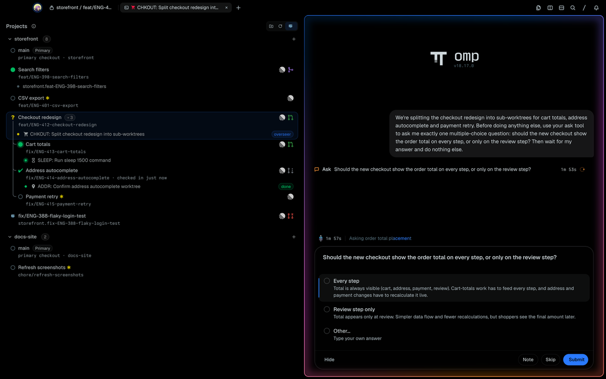

<div align="center">

<h1></h1>

**Mission control for parallel agent work.**

[](https://github.com/mmnavarr/overseer/releases/latest)
[](LICENSE)

[](https://docs.stencil.so/tern/)

One panel for every branch you have in flight: its worktree, its agents, its pull request and its ticket.<br>
Click a row and you're in that branch's own workspace.



</div>

---

Running five agents on five branches means five checkouts, a pile of terminals, and losing track of which agent is stuck waiting for you. Overseer is a [Tern](https://docs.stencil.so/tern/) plugin that keeps them all in one panel.

- **One session per worktree.** Each branch gets its own Tern session with its own tabs and agents. Switching is one click.
- **See every agent at a glance.** Working, waiting for you, finished or failed, right on the row.
- **Sub-worktrees.** When an agent splits a task into one branch per fix, the fixes nest under the task, and their agents keep each other informed.
- **PRs and tickets on the row.** GitHub PR state and the Linear ticket, one click away.
- **Quiet worktrees.** Creation and deletion run through [Worktrunk](https://worktrunk.dev) in the background, hooks and all.
- **Visualize PR.** Turns a pull request into a diagram-first outline for review.

### Works with your agents

| | Any agent CLI | [omp](https://omp.sh) |
|---|:-:|:-:|
| Sessions per worktree, status on every row, PRs and tickets | ✓ | ✓ |
| Overseer's wake-ups and briefs, with agent coordination on | ✓ | ✓ |
| Agents started from a ticket, Visualize PR, sub-worktrees made by agents | | ✓ |
| Family news before each prompt, agents messaging each other | | ✓ |

Claude Code, Codex, Gemini, Aider and others get the panel, their status and Overseer's messages; omp unlocks the rest. Nothing else to install.

## Install

Run this in any terminal:

```sh
tern plugin install github.com/mmnavarr/overseer
```

That's it. Tern downloads Overseer into its own plugins folder and loads it; no clone, no build. Press <kbd>⌘</kbd><kbd>⌥</kbd><kbd>⇧</kbd><kbd>P</kbd> to open Projects.

**You'll need** macOS, [Tern](https://docs.stencil.so/tern/) 0.9.15 or later, and [Worktrunk](https://worktrunk.dev) (`brew install worktrunk`; tested with 0.40 and 0.81). These are optional and add features:

| Add | To get |
|---|---|
| [GitHub CLI](https://cli.github.com) (`gh`), signed in | PR badges, Visualize PR |
| [Linear CLI](https://github.com/schpet/linear-cli) (`linear`), signed in | Ticket links |
| [omp](https://omp.sh) | Ticket agents, Visualize PR, sub-worktrees made by agents, agents messaging each other (Overseer sets up its omp side itself) |

**Update** with the **Update** button that appears beside the cog in the Projects header when a newer version is out, or with `tern plugin install github.com/mmnavarr/overseer --force`. **Uninstall** with `tern plugin remove overseer` (and `omp plugin uninstall overseer-omp` if you use omp).

## Use it

1. **Show Projects** with <kbd>⌘</kbd><kbd>⌥</kbd><kbd>⇧</kbd><kbd>P</kbd>.
2. **Add a repo** with **+** in the panel's header.
3. **Open a worktree** by clicking its row.
4. **Start a new one** with **+** next to a project.
5. **Right-click** a worktree or project for everything else, and open **Settings** with the cog next to Projects: the Ice Box, each project's base branch, Linear workspace and agent coordination, your GitHub and Linear sign-ins, and the changelog. Its **Usage** tab shows what your omp sessions cost, by project and worktree.

<table>
<tr>
<td width="50%"></td>
<td width="50%">

| You see | It means |
|---|---|
| ● green | Session open |
| ● pulsing green · amber · red | Agent working · setup creating the worktree · deleting it |
| ? in an amber circle | Agent waiting for you |
| ✓ in a green · ! in a red circle | Agent finished · failed while you were away |
| ○ hollow | No session yet |
| **✱** amber | Uncommitted changes |
| **▾ 3** | Three sub-worktrees (click to fold) |
| **Creating** | Setup running; **Needs you?** if it's asking something |
| 🧊 | Parked in the Ice Box |
| Linear logo · PR icon | The branch's ticket · its PR state |

</td>
</tr>
</table>


### Start work from a ticket

Ask Tern's assistant:

> Create an overseer worktree for ENG-123

You get the branch, its session and an omp agent already reading the ticket.

## Sub-worktrees

A task's worktree can own the worktrees of its sub-tasks. Agents create them for you (or use **Move under…**), each with its own session, PR and ticket, folded under the task with **▾ N**.

Turn on **agent coordination** from a project's right-click menu and their agents stay in touch: the task's agent is woken when a sub-task's agent needs an answer, fails or opens a PR, sub-tasks hear when the task's branch moves, and **Brief sub-worktrees…** messages them all. omp agents also hear their family's news before every prompt and can message each other. Messages only inform; they never trigger actions. It's off until you turn it on, per repository.

## Visualize a PR


Right-click a worktree with a pull request → **Visualize PR**. It's read-only: the agent writing the outline can't push, comment or edit anything.

## How it works


Worktrunk owns the worktrees, Tern owns the sessions, and Overseer never deletes a branch.

## Troubleshooting

- **"Worktrunk (wt) was not found".** Run `brew install worktrunk`. Overseer looks on Tern's PATH, then in `/opt/homebrew/bin`, `/usr/local/bin`, `~/.bun/bin` and `~/.local/bin`.
- **No PR badges.** Sign in with `gh auth login`. Badges only show for repositories whose `origin` is on GitHub.
- **No ticket links.** Sign in with `linear auth login`, or pick a workspace with **Set Linear workspace…** on the project's right-click menu. The branch name needs a ticket ID such as `ENG-123`.
- **A new worktree says "needs you?".** Setup is asking a question, usually a Worktrunk hook approval. Click the row, or **Answer** on its notification, to answer it.
- **Agents in a task don't hear from each other.** Turn on **agent coordination** from the project's right-click menu. omp sessions started before Overseer linked its omp side need `/new`.
- **Anything else.** **Show Overseer's operation log** in the command palette shows what Overseer did and how it ended, newest first, over the tab you're in. If that doesn't explain it, [open an issue](https://github.com/mmnavarr/overseer/issues/new/choose) with your Tern and Worktrunk versions.

## Contributing

Bug reports and pull requests are welcome. Please [open an issue](https://github.com/mmnavarr/overseer/issues/new/choose) before starting on a feature, so we can check it isn't already there or planned. [CONTRIBUTING.md](CONTRIBUTING.md) covers setup and the checklist; [AGENTS.md](AGENTS.md) is the full reference to how Overseer works.

## Credits

Built on [Tern](https://docs.stencil.so/tern/), [Worktrunk](https://worktrunk.dev) and [omp](https://omp.sh). PR icons from [Primer Octicons](https://primer.style/octicons/); Visualize PR follows [humanlayer/skills](https://github.com/humanlayer/skills)' visual-pr skill; the ticket icon is [Linear's logo mark](https://linear.app/brand), a trademark of Linear Orbit, Inc. See [CHANGELOG.md](CHANGELOG.md) for releases and [LICENSE](LICENSE) (MIT).
